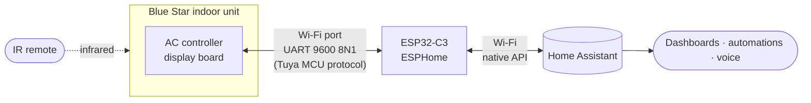
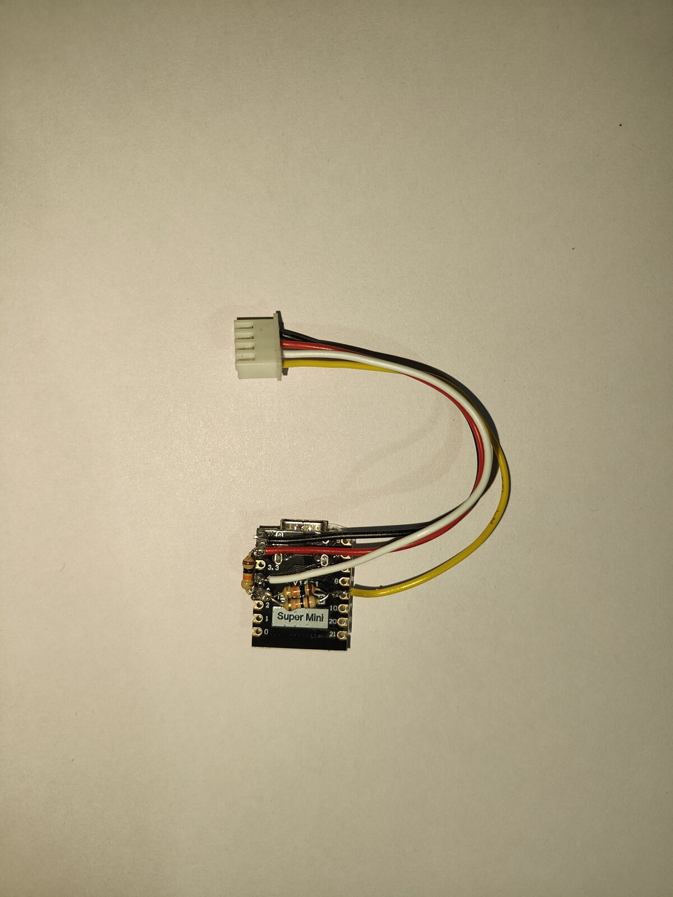
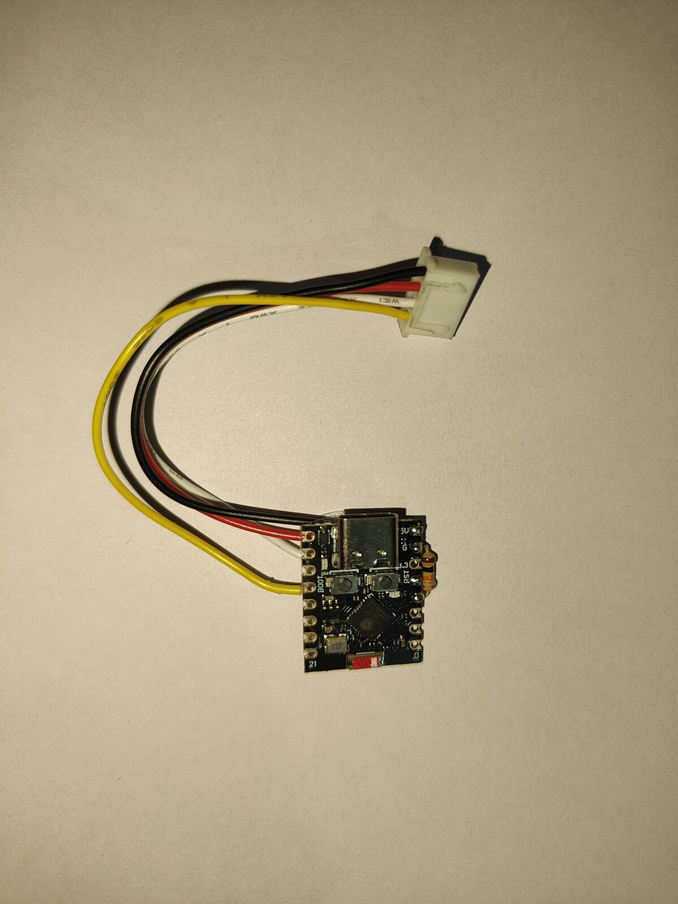
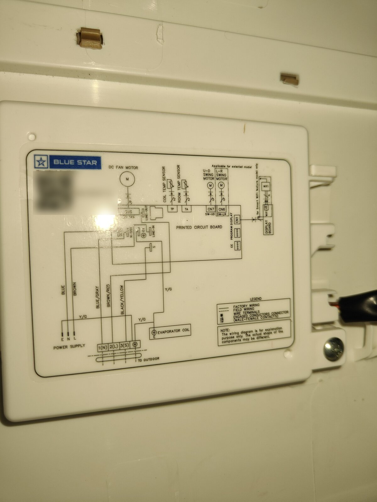
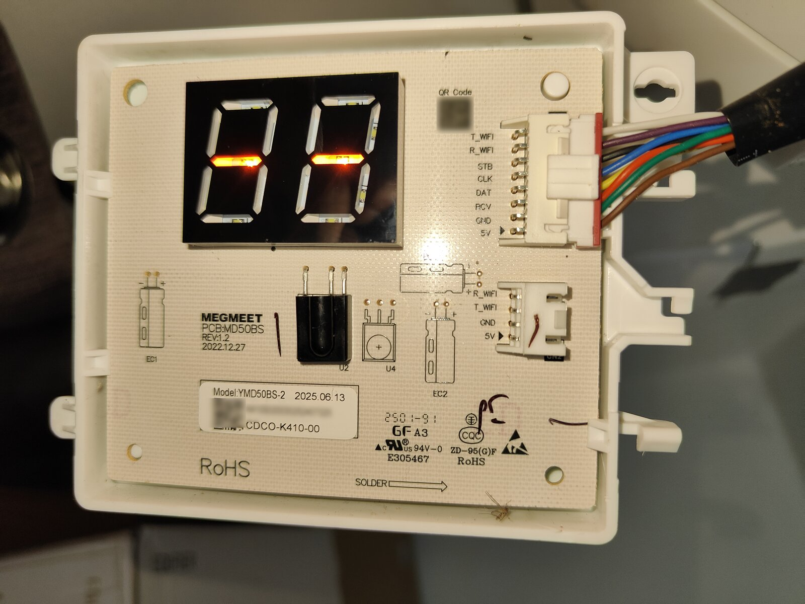
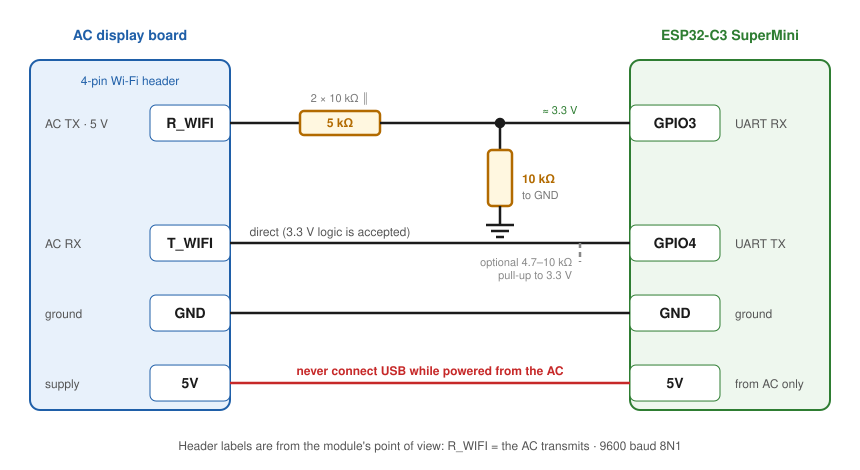
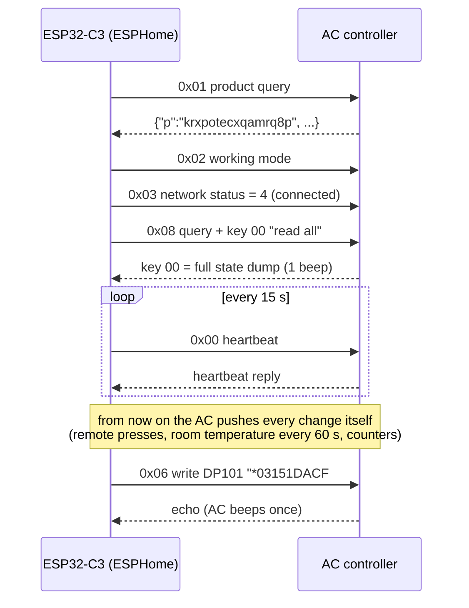

# Blue Star AC → ESPHome (local control, no cloud)

Blue Star "smart ready" (Wi-Fi ready) inverter split ACs ship with an **empty Wi-Fi port** on the indoor unit,
meant for Blue Star's optional, separately sold Wi-Fi module. This project makes such an AC smart by plugging a
**~₹250 / $3 ESP32-C3** running [ESPHome](https://esphome.io/) into that port. You get a native **Home Assistant**
climate entity with everything the remote can do, plus a few things it can't. Fully local: no app, no cloud
account, no internet needed.

As far as I could find, this is the **first public documentation of the Blue Star Wi-Fi port protocol**. The
protocol, the firmware and every quirk below were worked out from scratch. If you own a different Blue Star
model, please test it and report back (see [Contributing](#contributing)).



<p align="center">
  
  
  
</p>

---

## Contents

- [Tested models](#tested-models)
- [What you get in Home Assistant](#what-you-get-in-home-assistant)
- [Hardware](#hardware)
- [Wiring](#wiring)
- [How the ESP talks to the AC](#how-the-esp-talks-to-the-ac)
- [Firmware: build and flash](#firmware-build-and-flash)
- [Home Assistant setup](#home-assistant-setup)
- [Gotchas (read these before you start)](#gotchas-read-these-before-you-start)
- [Limitations](#limitations)
- [Open questions / help wanted](#open-questions--help-wanted)
- [How it was reverse-engineered](#how-it-was-reverse-engineered)
- [Related projects](#related-projects)
- [Contributing](#contributing)
- [Disclaimer and licence](#disclaimer-and-licence)

Full protocol reference: **[docs/PROTOCOL.md](docs/PROTOCOL.md)**

---

## Tested models

| Model | Indoor display board | Status | Notes |
|---|---|---|---|
| **IE518TNUR** | Megmeet MD50BS | ✅ in daily use | Reference unit: protocol decoded on this model. Compressor counter = 30 min per tick. |
| **IA318MXU** | Megmeet MD50BS | ✅ in daily use | Same port, same protocol. Compressor counter = 15 min per tick (set `compressor_ticks_per_hour: "4.0"`). Its state dump is longer and exposes the filter-clean (FC) flag. |

Both are cooling-only inverter splits with the same display board, the same 4-pin `R_WIFI T_WIFI GND 5V` header
and the same protocol (IE518TNUR reports Tuya product ID `krxpotecxqamrq8p`). Other Blue Star models sold as
"smart ready" / "Wi-Fi ready" very likely share it, but that is **unverified**.

## What you get in Home Assistant

**Climate entity**

| Feature | Details |
|---|---|
| Modes | Off · Cool · Dry · Fan · Auto ("AI Pro") |
| Setpoint | 16–30 °C in **0.5 °C** steps (the remote only does whole degrees) |
| Fan | Quiet (a step below the remote's lowest) · Low · Medium · High · Turbo · Auto |
| Swing | off · vertical · horizontal · both |
| Presets | Turbo ("110 % boost") · Eco · Comfort Sleep |
| Room temperature | from the AC's own sensor, updated every 60 s |

**Extra entities**

- **Selects:** vane position (1 top … 5 bottom, swing, off) · convertible capacity (100/80/60/40 %) · season mode (Summer/Monsoon/Autumn)
- **Switches:** display light · buzzer mute
- **Sensors:** AC on-time and compressor run-time (lifetime hours, from the AC's own counters) · on/off-timer minutes · compressor speed (latched, see limitations) · raw keys for research · Wi-Fi signal · uptime · last reset reason · last received record
- **Buttons:** re-handshake with the AC · restart the ESP
- **Actions** for experiments: `esphome.<name>_send_record` (key, value) and `esphome.<name>_send_frame` (raw Tuya frame)

**Optional Home Assistant package** ([home-assistant/bluestar_ac_package.yaml](home-assistant/bluestar_ac_package.yaml)):
daily on-time and compressor hours, **compressor duty %**, compressor speed, a readable fan-speed sensor, and an
**effective setpoint** that follows Comfort Sleep's hidden +1 °C/h ramp.

Changes made with the IR remote show up in Home Assistant immediately, because the AC reports every change.

## Hardware

| Part | Notes |
|---|---|
| ESP32-C3 **SuperMini** | the tested board; other ESP32 boards should work with adjusted pins (untested) |
| 3 × 10 kΩ resistors | two in parallel (= 5 kΩ) + one to ground: a divider for the AC's 5 V TX |
| JST-XH 4-pin plug (2.5 mm pitch) | matches the AC's Wi-Fi header on both tested units |
| *Optional:* 4.7–10 kΩ pull-up | ESP TX → 3.3 V, prevents the reboot glitch (see gotchas) |

Where to find the port: on the **indoor unit's display board**, behind the front panel. The wiring diagram on
the inside of the cover shows it (*Wi-Fi → display board*, top right of the third photo above). On "smart ready"
units the 4-pin header is empty; this is where the ESP plugs in.

<p align="center"></p>
<p align="center"><sub>Megmeet MD50BS display board (removed from the unit). The ESP plugs into the empty 4-pin
<code>R_WIFI / T_WIFI / GND / 5V</code> header on the right, below the 8-pin main cable.</sub></p>

> ⚠️ **Mains voltage is present inside the indoor unit.** Switch the AC off at the breaker before opening it. You
> are only touching the low-voltage display board, but be careful anyway. Opening the unit may affect your
> warranty.

## Wiring

The labels are from the **module's** point of view: `R_WIFI` is where the module receives, so it is the AC's
**TX**.

| AC header | ESP32-C3 SuperMini | How |
|---|---|---|
| `R_WIFI` (AC TX, 5 V idle) | **GPIO3** (RX) | through **5 kΩ** (2 × 10 kΩ in parallel), with **10 kΩ from GPIO3 to GND** |
| `T_WIFI` (AC RX) | **GPIO4** (TX) | direct; optional 4.7–10 kΩ pull-up to 3.3 V |
| `GND` | `GND` | |
| `5V` | `5V` | powers the ESP from the AC |

<p align="center"></p>

The divider brings the AC's 5 V TX down to 5 V × 10 k / (5 k + 10 k) ≈ **3.3 V** for the ESP. The ESP's 3.3 V TX
into the AC's RX works without a level shifter on both tested units.

## How the ESP talks to the AC

The port speaks the standard **Tuya MCU serial protocol**, but the AC only starts talking after a specific
handshake, which the stock ESPHome `tuya:` component never completes. That is why this project has its own
component:



All settings travel as Blue Star key/value records inside one string data point (DP101):

```
 *  03  15  1  DACF  #
 │  │   │   │  │     └ end
 │  │   │   │  └ CRC-16/MODBUS over "*03151", uppercase hex
 │  │   │   └ value (hex)
 │  │   └ key 15 = display light
 │  └ length of key + value in hex (3 characters)
 └ start
```

Every key is listed in **[docs/PROTOCOL.md](docs/PROTOCOL.md)**.

## Firmware: build and flash

Developed and tested on **ESPHome 2026.10** with the **ESP-IDF** framework.

```sh
git clone https://github.com/Vikk20/bluestar-ac-esphome
cd bluestar-ac-esphome/esphome
cp secrets.example.yaml secrets.yaml      # fill in Wi-Fi + generate an API key
# edit bluestar-ac.yaml: name, friendly_name, compressor_ticks_per_hour for your model

# first flash over USB (AC disconnected!)
esphome run bluestar-ac.yaml --device /dev/ttyACM0
# later updates over Wi-Fi
esphome run bluestar-ac.yaml --device <esp-ip-or-hostname>
```

Then **unplug USB**, plug the module into the AC and switch the AC's mains back on. Within a few seconds the
ESP handshakes with the AC; you'll hear one beep as it reads the full state.

The firmware is a custom external component (`esphome/components/bluestar_ac`) because the stock `tuya:`
component never gets past the AC's init sequence (details in [PROTOCOL.md](docs/PROTOCOL.md#2-transport-tuya-mcu-serial-)).

## Home Assistant setup

1. Home Assistant discovers the ESP through the **ESPHome** integration. Add it with the API key from `secrets.yaml`.
2. *(Optional)* copy `home-assistant/bluestar_ac_package.yaml` into `<config>/packages/` for daily hours, duty,
   compressor speed and the effective setpoint. The entity IDs assume the friendly name "Blue Star AC".

The climate entity works with the standard thermostat card, voice assistants, schedules and automations.

## Gotchas (read these before you start)

These cost the most time. Learn from them:

1. **Use GPIO4/GPIO3, not GPIO20/21.** With TX/RX on 20/21 the AC silently dropped most frames and ignored
   writes; 4/3 worked first time.
2. **Never connect USB and the AC's 5 V at the same time.** The SuperMini has no diode between USB 5 V and the
   5 V pin.
3. **Lower the Wi-Fi TX power.** At the default 17 dB the SuperMini failed every Wi-Fi join with
   `Auth Expired`; `output_power: 8.5dB` fixed it. 11 dB also worked.
4. **Disable Wi-Fi power saving** (`power_save_mode: none`). With ESPHome's default light sleep, one unit's ping
   ranged 4–113 ms; with power saving off it dropped to 2–5 ms, and commands feel instant.
5. **Pick your access point.** If commands feel laggy, check the ping. One unit jittered 3–800 ms on a busy
   router and dropped to 3–12 ms when pinned to a different AP with ESPHome's `networks:` + `bssid:`.
6. **The AC beeps on every write.** The firmware therefore never polls: it reads the full state once at
   boot and then just listens (the AC pushes every change itself). Automations should only send what changed.
7. **Reboot glitch:** while the ESP reboots its TX line floats, and the AC can read garbage that silently turns
   the display light off. The firmware restores the light after boot; a pull-up on `T_WIFI` prevents it.
8. **OTA rollback:** if the ESP resets within 60 s of booting new firmware (e.g. you unplug it to rewire),
   ESP-IDF rolls back to the previous image. Wait a minute after an OTA before touching it.
9. After a USB flash the SuperMini sometimes stays in download mode (`boot:0x7` in the log): unplug and replug.

## Limitations

- **No energy metering.** No field in the protocol behaves like an energy or power counter. Add a smart plug or
  CT clamp if you need kWh.
- **Compressor speed is not live.** The AC only sends it together with each compressor-counter tick (every
  30 min of running on IE518TNUR, 15 min on IA318MXU). Asking for it in between returns the last latched value.
- **Turbo cancels itself** after ~17–20 minutes (AC firmware behaviour, same as with the remote).
- **No clock on the AC:** timers are "minutes from now". Clock-based timers belong in Home Assistant anyway.
- **Comfort Sleep's ramp is invisible:** the AC raises its real target internally; the package's effective
  setpoint sensor reconstructs it.
- Some remote features send nothing over the port (e.g. *Mode + Light*), so they can't be seen or triggered.

## Open questions / help wanted

| Key / field | What we know | What's missing |
|---|---|---|
| **k25** | one byte with every compressor tick, varies 0–255 | meaning. Not a counter, not power, no clean link to compressor speed |
| **k24 byte C** (IA318MXU) | steps 6 → 5 → 4 → 1, falls with speed and late at night | outdoor-fan stage? |
| **k62** | a temperature (23.5 °C), only on request | always 23.5 °C so far, even with 25.8 °C outside, so not outdoor ambient. Coil? Fixed value? |
| **k60** | counter at a fixed offset from k43 | why the offset differs per model |
| **k29, k61, k17, k30** | structured or constant values | meaning |
| **IA318MXU state dump** | 17 extra characters; position 103 = filter-clean flag | the rest |
| **Other models** | only two tested | does the same firmware work on yours? |

If you can measure your AC's power draw with a meter while logging, that would settle k25 and the energy
question for good.

## How it was reverse-engineered

1. **Listen to the port.** An ESP32 on the Wi-Fi header answered the AC's Tuya handshake (acting as the Wi-Fi
   module) and logged everything the AC sent at 9600 baud. Raw frames can be built with
   [`tools/tuya_send.py`](tools/tuya_send.py) and injected with the firmware's `send_frame` action.
2. **Identify the transport.** The `55 AA` headers gave away the standard Tuya MCU protocol. The interesting
   part is DP101, a string data point carrying Blue Star's own `*LLKKV…CCCC#` records with a CRC-16/MODBUS.
3. **Map the keys.** Press every remote button and combination while logging, then write test values to every
   unknown key (0x00–0x98) and watch what the AC echoes, rejects or changes.
4. **Turn it into the add-on.** The same ESP32-C3 grew into this firmware: it performs the Tuya-module
   handshake (which the stock ESPHome `tuya:` component doesn't), then exposes everything as a climate entity.
5. **Long-term logging.** The ESP streams every record via syslog. Days of logs from two models decoded the
   counters (on-time, compressor run-time) and the latched compressor speed (`tools/ac_events.py`).

## Related projects

- [Mitsubishi CN105 (SwiCago/HeatPump, mitsubishi-local)](https://github.com/szamfirov/mitsubishi-local): the classic "plug an ESP into the AC's adapter port" project
- [Gree AC over UART (esphome_gree_ac)](https://github.com/piotrva/esphome_gree_ac), [Gree protocol notes](https://github.com/bekmansurov/gree-hvac-protocol)
- [JHS AC Wi-Fi header protocol](https://github.com/hutchx86/jhs-ac-protocol), [TCL/Kesser AC-hack](https://github.com/adaasch/AC-hack)
- [Blue Star IR remote decoding](https://techantidote.com/decoding-ir-signals-of-a-blue-star-air-conditioner-using-an-arduino/): IR only, not the serial port
- [ESPHome Tuya MCU component](https://esphome.io/components/tuya.html): stalls at this AC's init handshake, hence the custom component

## Contributing

Issues and pull requests are very welcome, especially:

- **Another Blue Star model?** Open an issue with the model number, a photo of the Wi-Fi header and the ESP log
  of the first boot (the long `Record 00=` line). If the compressor hours look wrong, try the other
  `compressor_ticks_per_hour` value and say which one fits.
- **Decoded an unknown key?** Add it to [docs/PROTOCOL.md](docs/PROTOCOL.md) with how you confirmed it.
- Logs help most. Enable the optional `syslog:` block and run `tools/ac_syslog.py` on any machine to collect
  days of data, then `tools/ac_events.py` to summarise them.

## Disclaimer and licence

This is an independent hobby project, not affiliated with or endorsed by Blue Star Limited or Tuya. You modify
your AC at your own risk. Mains voltage can kill, and opening the unit may void your warranty.

Code and documentation: [MIT licence](LICENSE).
